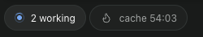

# Cache warmth for Paseo

A live prompt-cache timer for Claude agents in [Paseo](https://paseo.sh).



## Install

Enable plugins in Paseo settings, then run:

```bash
paseo plugin add git:xhyumiracle/paseo-cache-warmth
```

Or hand it to your agent:

```text
Install the Paseo plugin at github.com/xhyumiracle/paseo-cache-warmth
```

## What it shows

| Pill | Meaning |
| --- | --- |
| `cache 54:03` | Warm. Time left before it expires. |
| `cache live` | A turn is running. |
| `cache cold` | Expired, or the model changed. |
| `cache ?` | Not enough data, e.g. right after a compaction. |

Claude agents only.

## How it stays accurate

- **Cache lifetime**: read from the transcript. Claude Code records 5 min or 1 h per request.
- **Start time**: the message the last request was built on. It is logged before the request is sent, so the timer may end early, never late.
- **Forked or resumed sessions**: it follows the conversation's parent links, like Claude Code does.

## Privacy and cost

- Read-only. Sends nothing anywhere.
- Reads the transcript tail on load and when a turn ends. Idle agents cost nothing.

## Limits

- Early eviction by the provider is invisible.
- Thinking-level changes are not tracked.

## Develop

```bash
npm install && npm test
```

MIT
